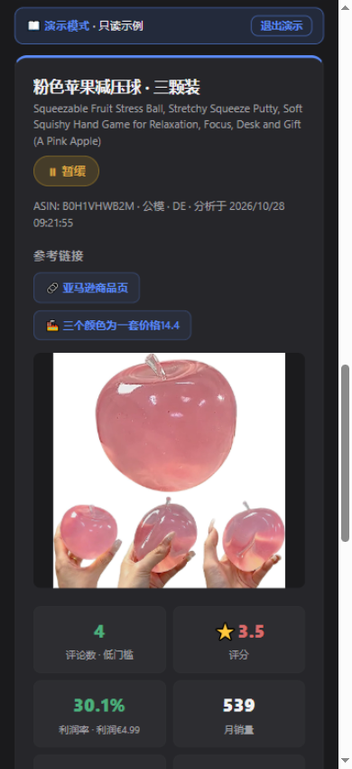
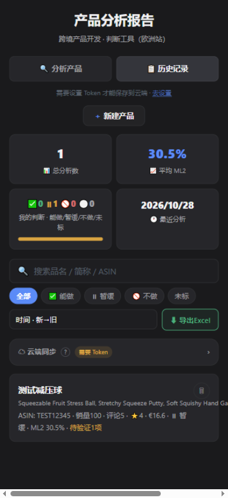

# 产品分析工具 · 亚马逊欧洲站

把 ML2 利润核算、FBA 费率查表、差评分析流程化的在线选品工具（德国站为主，支持德法意西）。

**在线使用**：<https://fengdageng-tech.github.io/product-analyzer/>

| 分析报告 | 历史记录 |
| --- | --- |
|  |  |

## ✨ 核心功能

- **ML2 欧洲站口径实时核算**：佣金 15.4% · 分国增值税 · 头程按公斤摊入，填定价即时显示利润率与达标售价
- **FBA 费率内置查表**：德法意西 4 国 × 6 尺寸级别 × 各重量段，填重量自动出运费，超重自动拦截；费率表可自助编辑并标注版本
- **差评分析**：差评文本按痛点自动归类，区分可改善问题与硬伤
- **快速试算**：报告页直接点售价 / 采购 / FBA 数字改，利润拆解实时重算，一键恢复原值
- **待验证事项**：暂缓的品把前提条件记下来，逐项打勾跟进，历史列表一眼看到每条欠什么验证
- **数据管理**：搜索 / 按判断筛选 / 按 ML2 排序 / 一键导出 CSV（Excel 可直接打开）· 回收站 · 公有云页面 + 私有仓库存数据

## 💡 设计思路

- 套装品类按「每颗价」比价，避免客单价对比错觉
- 保底价 = 保本线；达标价 = 目标利润率（默认 ML2 30%）反推
- 汇率默认自动取当天欧元牌价，手动填写优先
- 访客无需登录即可在首页点「看示例报告」体验完整流程（只读）

## 🔒 数据与隐私

- 记录只保存在**浏览器本地** + **你自己的 GitHub 私有仓库**（`product-analyzer-data`），读写都需要 Token，别人打开这个网址看不到任何数据
- 首次使用不设 Token 也能用，记录只存在当前设备

---

业务逻辑独立完成，AI 辅助实现。
